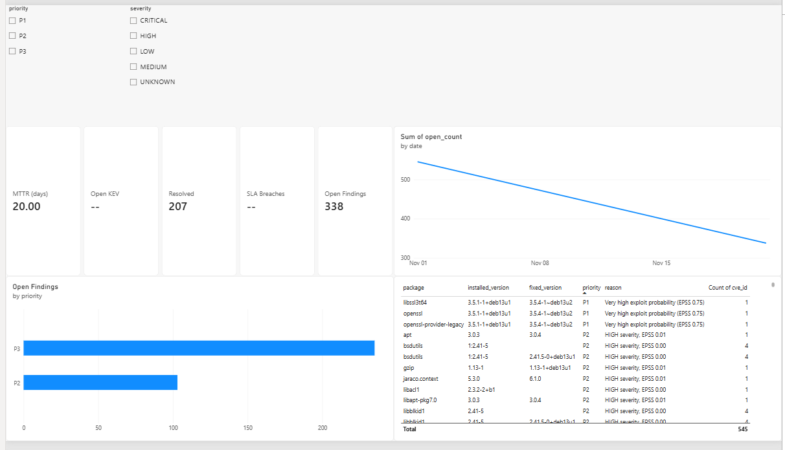
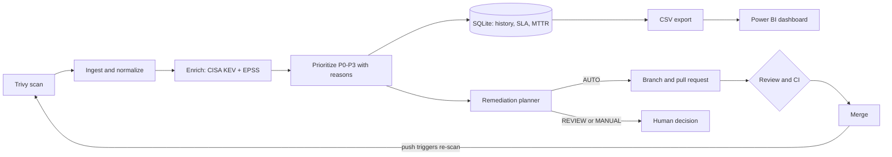

# Patch Pilot

An automated vulnerability-to-patch pipeline. It ingests scanner output, prioritizes findings by real-world exploit risk, tracks SLAs and time-to-remediate, and opens pull requests for the upgrades that are safe to automate, leaving risky ones to a human.



## Why

Scanners produce hundreds of findings and most never get exploited. Ranking by CVSS alone sends people after the wrong things. Patch Pilot ranks by exploitation evidence and probability, groups findings into upgrade actions, and automates the low-risk part of the fix.

## How it works



The pipeline runs in GitHub Actions on a nightly schedule, on pushes to `main`, and on demand.

## Decision policy

| Condition | Action |
|---|---|
| Fix available, patch or minor version bump | **AUTO**: included in a pull request |
| Fix requires a major version bump | **REVIEW**: held for a human (possible breaking changes) |
| No fix available | **MANUAL**: mitigate or accept the risk |

Priority tiers (P0 to P3) come from CISA KEV membership, EPSS probability, and scanner severity. Every finding stores a plain-language reason for its tier, so a decision can be explained to an auditor.

## Results (demo)

- A scan of a public `python:3.9-slim` image produced 545 findings. Removing the fixed OpenSSL packages in a simulated second scan resolved 207 of them, giving a 20-day MTTR in the dashboard.
- On the demo app, the pipeline proposed 2 safe upgrades (`requests`, `pyyaml`) in a pull request and held back 2 major upgrades (`urllib3`, `jinja2`) for review. After the merge, the next automatic run no longer listed the upgraded packages.

## Run it

Requirements: Python 3.11, Docker, Git.

```bash
python -m venv .venv && source .venv/Scripts/activate   # Windows Git Bash
pip install -r requirements.txt

# Scan the demo app
mkdir -p data
docker run --rm -v "$(pwd):/src" aquasec/trivy:latest fs --format json --output /src/data/scan_demo.json /src/demo-app

# Run the pipeline (dry run), or add --apply to create the upgrade branch
python src/run_pipeline.py
python -m unittest discover -s tests -v
```

## Design decisions

- **Normalized finding model:** scanners differ. One internal schema means adding another scanner doesn't touch the prioritization logic.
- **Tiered autonomy:** the bot never merges or pushes to the main branch. It proposes, and humans or CI approve.
- **Explainability:** deterministic scoring rules with stored reasons, not an opaque model.
- **Prototype scope:** SQLite and CSV exports keep it simple. See limitations below.

## Limitations and next steps

- State is kept with the Actions cache. A real deployment would use a managed database.
- Pull requests opened with the built-in token don't run CI automatically. A production setup would use a GitHub App or service account so tests gate every automated PR.
- Only Trivy output and Python dependency files are handled so far.
- Not built yet: LLM-assisted triage of advisories and changelogs (with prompt-injection guardrails), a re-scan verification gate before merge, and ticket creation for REVIEW and MANUAL items.

## License

MIT